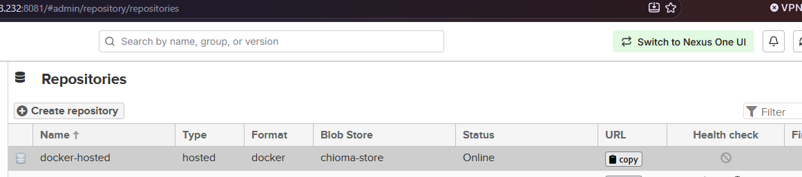
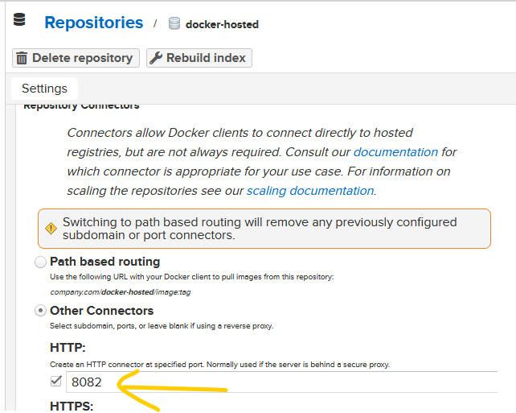
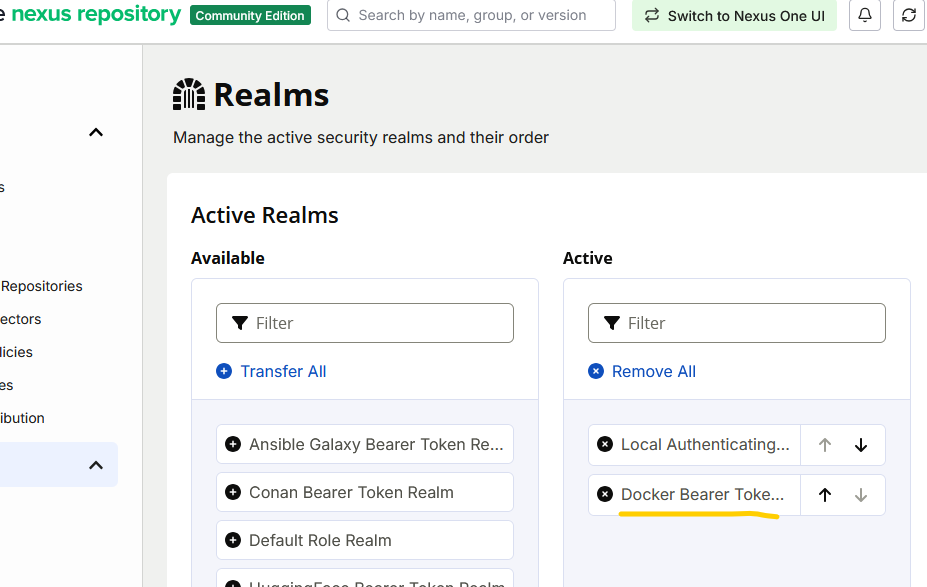
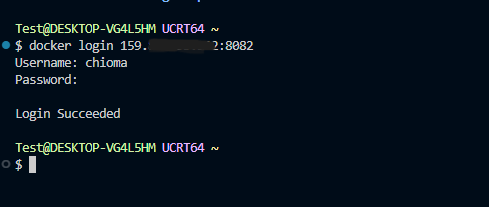
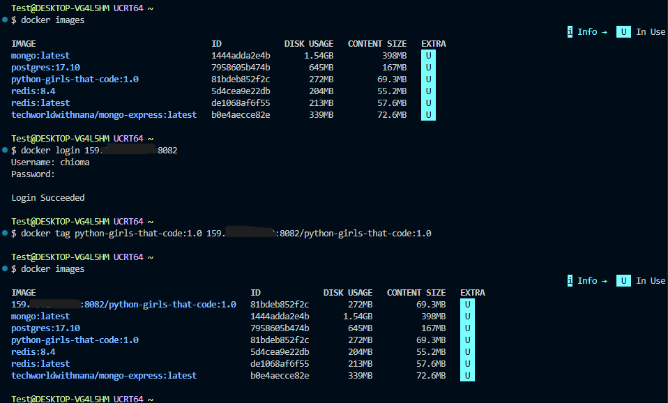
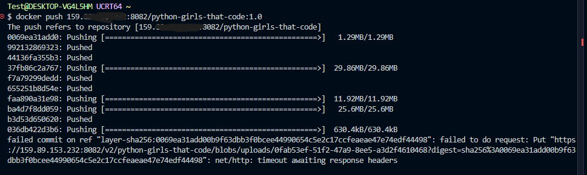
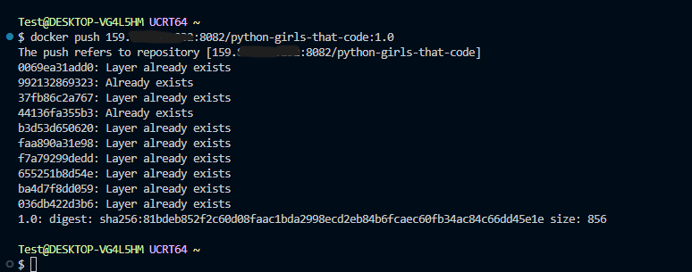
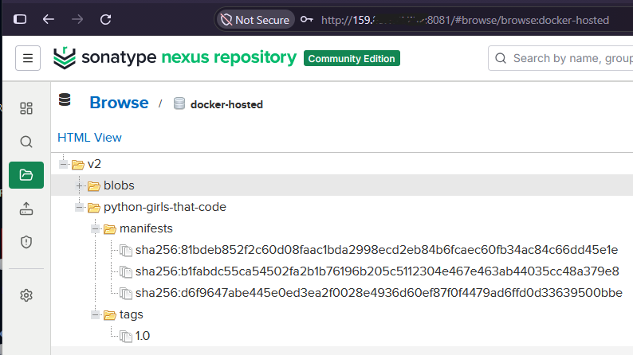

# Dev7b — Private Docker Registry with Sonatype Nexus

**Provisioning a Nexus Docker hosted repository on DigitalOcean and publishing a containerised FastAPI application**

   

> **Project path:** [Dev7a — Dockerising Python Girls That Code](https://github.com/ChiomaScripts/Dev7a-docker-python) → **Dev7b — Publishing the image to Nexus (this repository)** → **Dev7c — Docker Compose and persistent volumes (next)**.
>
> This repository documents the registry infrastructure, image publication workflow, and troubleshooting. The FastAPI application source and Dockerfile remain in **Dev7a**; they are intentionally not duplicated here.

## 1. Project overview

In Dev7a, I containerised my **Python Girls That Code** FastAPI application and ran it locally alongside MongoDB and Mongo Express. That gave me a working Docker image on my local Docker Engine, but it did not make the image available from a dedicated private registry.

For Dev7b, I took that existing application image and published it to a **Docker hosted repository in Sonatype Nexus Repository Manager**, running on a **DigitalOcean Ubuntu droplet**. I provisioned the server, configured the repository and its connector, enabled Docker-specific authentication, created a publishing role and user, authenticated from Docker Desktop, tagged the existing image with the registry address, and pushed it to Nexus.

The first pushes timed out while finalising some layers. Instead of rebuilding the application, I investigated the Nexus process, network listeners, memory, disk usage, and application logs. A later retry succeeded; previously uploaded layers were recognised as already existing. The final image tag and manifests were visible in the Nexus UI.

**Outcome:** Successfully published `python-girls-that-code:1.0` to a self-hosted Nexus Docker registry and verified it in the Nexus repository browser.

## 2. Why this project matters

A Docker image existing on a developer's laptop is not the same as an image being distributed through a registry. Registries provide a shared location from which authorised systems can **push** and **pull** versioned images. This is a foundational workflow for deployment automation and CI/CD: build an application image once, publish it, and let downstream environments retrieve that exact artifact.

**Key distinction:**

| Concept | Purpose | In this project |
|---|---|---|
| Dockerfile | Instructions used to build an image | Maintained in Dev7a |
| Docker image | Packaged application and runtime dependencies | `python-girls-that-code:1.0` |
| Docker Engine / Docker Desktop | Builds, stores and runs local images and containers | Local Windows development machine |
| Container | Running instance of an image | Used in Dev7a; not required to push an image |
| Registry | Service that stores and distributes container images | Nexus on DigitalOcean |
| Hosted repository | Nexus-managed destination accepting image pushes | `docker-hosted` |
| Image tag | Human-readable label associated with an image | `1.0` |
| Digest | Content-addressed identifier | `sha256:...` in successful push output |

### High-level architecture

```mermaid
flowchart LR
    A[Dev7a FastAPI source + Dockerfile] --> B[Local Docker Engine]
    B --> C[Existing application image]
    C --> D[Tag with registry host:port]
    D --> E[Docker login + push]
    E --> F[DigitalOcean Ubuntu droplet]
    F --> G[Nexus Repository Manager]
    G --> H[Docker hosted repository]
    H --> I[Image layers + manifest + tag 1.0]
    I -. Future pull .-> J[Dev7c Docker Compose]
```



> The diagram represents the artifact flow. The registry was hosted remotely, while Docker commands were run from my Windows machine. Dev7c is a subsequent project, not part of this completed exercise.

## 3. Environment and technologies

| Component | Configuration / role |
|---|---|
| Cloud provider | DigitalOcean |
| Server | Ubuntu Linux droplet, **2 vCPUs, 4 GB RAM, 80 GB disk** |
| Repository manager | Sonatype Nexus Repository Manager Community Edition |
| Nexus web UI | HTTP port **8081** |
| Nexus Docker hosted connector | HTTP port **8082** |
| Nexus hosted repository | `docker-hosted` |
| Blob store | `chioma-store` |
| Client | Docker Desktop on Windows; Git Bash / terminal |
| Application image | `python-girls-that-code:1.0` from Dev7a |
| Registry image reference used in the lab | `159.**.***.***:8082/python-girls-that-code:1.0` |

**Lab-specific note:** The IP address shown in screenshots and commands is the historical endpoint used for this exercise, not a promise that the server is still available. Replace it with the address of your own registry when reproducing the lab.

## 4. Provisioning and configuring Nexus

### 4.1 Provision the server and launch Nexus

I provisioned a DigitalOcean Ubuntu droplet and installed and started Nexus Repository Manager. The Nexus UI was accessible on port `8081`. Nexus itself ran as a Java process on the droplet; the investigation later confirmed the process and listening ports.

The server hosts **Nexus**, whereas my Windows laptop hosts **Docker Desktop**. Docker Desktop communicates with the remote registry; I did **not** install Docker Engine on the Nexus droplet to perform this push.

### 4.2 Create the Docker hosted repository

In Nexus, I created a **Docker (hosted)** repository named `docker-hosted`, backed by the `chioma-store` blob store. A hosted repository accepts artifacts published directly by authorised clients. This is different from a **proxy** repository, which caches artifacts fetched from another registry, or a **group** repository, which combines multiple repositories behind one endpoint.



*Figure 1 — Nexus repository list showing the `docker-hosted` Docker repository and its blob store. Source: learning notes, page 1, upper screenshot.*

### 4.3 Configure the Docker connector

The Nexus UI uses port `8081`, but Docker clients need the Docker Registry HTTP API endpoint. I selected **Other Connectors** and configured the repository's **HTTP connector on port `8082`**. The droplet firewall was configured to allow the Docker client to reach that port during the lab.



*Figure 2 — Docker repository connector configuration showing HTTP port `8082`. Source: learning notes, page 1, middle screenshot.*

**Why two ports?** `8081` serves the Nexus management interface. `8082` is the registry endpoint to which the Docker CLI sends `/v2/` requests. The Nexus user does **not** own port `8082`; it is a repository connector.

### 4.4 Configure authentication and publishing permissions

I enabled the **Docker Bearer Token Realm** in Nexus and created a dedicated publishing role (`nx-docker`) and user for Docker access. The realm enables Docker registry token authentication; the role and its repository privileges govern what the user may do.

For a publishing account, the relevant repository permissions generally include **browse**, **read**, and **add** on the Docker hosted repository. **Edit** may be needed for workflows that update or replace existing content, depending on Nexus policies. The screenshots document realm activation, while the exact privilege list is not captured in the supplied notes.



*Figure 3 — Docker Bearer Token Realm shown under active Nexus realms. Source: learning notes, page 1, lower screenshot.*

### 4.5 Configure the local Docker client for this HTTP lab

Docker ordinarily expects a secure HTTPS registry for non-local endpoints. Because this temporary exercise used an **HTTP** Nexus connector, I added the Nexus `host:port` to Docker Desktop's **Docker Engine → `insecure-registries`** configuration and applied the change.

Example fragment (merge this property into the existing Docker Engine JSON rather than replacing other settings):

```json
{
  "insecure-registries": ["159.**.***.***:8082"]
}
```

> **Security and reproducibility:** An insecure registry allows unencrypted HTTP communication. This lab configuration is **not a production recommendation**: registry credentials and image traffic can be exposed in transit. For production, use HTTPS/TLS and restrict access. For a short-lived lab, use a unique disposable credential, minimise firewall exposure, and remove the insecure-registry entry and firewall allowance after the exercise. Do not commit passwords, Docker credential files, or tokens to Git.

## 5. Authenticate, tag and publish the image

### 5.1 Verify that the existing image is available

I had already built the application image in **Dev7a**, so there was no need to run `docker build` again. The `docker images` command queries the currently selected Docker Engine, regardless of the terminal's working directory.

```bash
docker images
```

**Principle:** Rebuild only if the application or Dockerfile has changed and the published artifact should incorporate those changes. Registry publishing does not inherently require rebuilding.

### 5.2 Log in to the Nexus registry

```bash
docker login 159.**.***.***:8082
```

I authenticated using the Nexus publishing user, and Docker returned **`Login Succeeded`**. This confirms authentication; it does not by itself prove that the account can push every repository.



*Figure 4 — Successful Docker CLI login to the Nexus registry. Source: learning notes, page 2, upper screenshot.*

### 5.3 Tag the existing image for the target registry

```bash
docker tag python-girls-that-code:1.0 \
  159.**.***.***:8082/python-girls-that-code:1.0
```

The first argument is the existing local image reference; the second is the new reference identifying its publishing destination. **`docker tag` creates another image reference; it does not rebuild the image or duplicate its underlying layers.**



*Figure 5 — `docker images` before and after tagging, showing the original image and the Nexus-qualified reference. Source: learning notes, page 2, middle screenshot.*

#### Anatomy of the image reference

```text
159.**.***.***:8082/python-girls-that-code:1.0
└──── registry ────┘ └──── image ──────┘ └tag┘
```

- **Registry host and port:** Tells Docker which registry to contact.
- **Image repository name:** Identifies the image within that registry.
- **Tag:** Identifies a named version of that image.

When a registry hostname is omitted, Docker normally resolves unqualified image names through **Docker Hub** defaults. It does not automatically discover my Nexus instance. That is why the explicit Nexus address matters.


### 5.4 Push the image

```bash
docker push 159.**.***.***:8082/python-girls-that-code:1.0
```

The `docker push` command publishes the image's required content and manifest to the named registry. Docker can avoid retransmitting layers that the registry already possesses.

## 6. Troubleshooting: repeated timeouts during push

The first push did not complete. Some layers were marked **`Pushed`**, while other transfers reached **100%** before Docker reported:

```text
failed to do request: Put ... /v2/python-girls-that-code/blobs/uploads/...
net/http: timeout awaiting response headers
```



*Figure 7 — Failed push showing successful layer transfers alongside a timeout during a blob upload finalisation request. Source: learning notes, page 3, upper screenshot.*

### 6.1 What the error meant

The request targeted the Docker Registry HTTP API's **blob upload** path. Docker had been waiting for the registry's HTTP response while completing a layer upload. A progress bar reaching **100%** indicates the layer's bytes were transferred from the client's perspective; it does not guarantee the registry has completed and acknowledged the operation.

A timeout at this stage can arise from network interruption, slow server-side processing, storage latency, or other HTTP handling issues. **The exact root cause in this lab was not conclusively established.**

### 6.2 Checks performed

I investigated the DigitalOcean droplet rather than rebuilding the image repeatedly:

```bash
# Inspect available memory and swap
free -h

# Inspect filesystem capacity
df -h

# Check whether a systemd service named nexus exists
sudo systemctl status nexus

# Find Nexus-related processes
ps aux | grep -i nexus

# Verify listeners for the UI and Docker connector
sudo ss -lntp | grep -E '8081|8082'

# Inspect recent Nexus application logs
tail -n 100 /opt/sonatype-work/nexus3/log/nexus.log

# Filter log messages relevant to uploads and errors
sudo grep -Ei 'docker|blob|upload|timeout|exception|error' \
  /opt/sonatype-work/nexus3/log/nexus.log | tail -n 60
```

**Observed results:**

| Diagnostic | Observation | Interpretation |
|---|---|---|
| `free -h` | ~3.8 GiB total RAM; ~1.1 GiB available; no swap | Some memory pressure, but no proof of exhaustion |
| `df -h` | ~73 GiB free on root filesystem | Disk capacity was not exhausted |
| `systemctl status nexus` | `Unit nexus.service could not be found` | No service registered under that exact name; **not** proof Nexus was down |
| `ps aux` | Nexus Java process present | Nexus application was running |
| `ss -lntp` | Ports `8081` and `8082` listening under Java | UI and registry connectors were bound |
| Nexus logs | Background tasks and some H2/PostgreSQL feature warnings | No conclusive blob upload error in the excerpts examined |

The Java process was configured with an approximately **2.7 GiB heap** on a **4 GiB** droplet, a potential resource consideration, but there was no evidence sufficient to label it the cause. Likewise, warnings about features requiring PostgreSQL did **not** establish that Docker publishing required a database migration.

### 6.3 Successful retry and what it taught me

After several unsuccessful attempts, a subsequent push succeeded. Docker reported **`Layer already exists`** for the layers previously uploaded, followed by a final image digest:

```text
1.0: digest: sha256:81bdeb852f2c60d08faac1bda2998ecd2eb84b6fcaec60fb34ac84c66dd45e1e size: 856
```



*Figure 8 — Successful push, showing `Layer already exists` and the final manifest digest. Source: learning notes, page 3, middle screenshot.*

**Lessons:**

1. Docker images are made up of content-addressed layers; a registry can recognise layers it already has.
2. A failed push does not necessarily mean every previously uploaded layer was lost.
3. Retrying a push can be efficient because existing layers need not be sent again.
4. A successful final digest is stronger evidence of a completed push than individual layer progress bars.
5. Troubleshooting should distinguish **observations**, **possible causes**, and **confirmed root causes**.

## 7. Verify the published artifact in Nexus

In the Nexus UI, I opened **Browse → `docker-hosted`** and found the image repository, its manifests, and the `1.0` tag. This corroborated the successful CLI output and confirmed that the artifact was present in the registry.



*Figure 9 — Nexus Browse view displaying `python-girls-that-code`, manifests, and tag `1.0`. Source: learning notes, page 3, lower screenshot.*

### Image layers, manifests, tags and digests — a refresher

- **Layers** are reusable filesystem content units composing an image. Multiple images can share layers.
- **Image manifest** describes the image's constituent content, including references to layers and its configuration. Docker publishes this metadata after the required blobs are available.
- **Tag** (`1.0`) is a convenient name that can be reassigned to different content if the repository permits it.
- **Digest** (`sha256:...`) identifies content cryptographically. A digest is useful when reproducibility matters because it refers to specific content rather than a potentially movable tag.
- **`Layer already exists`** means the target registry already has that layer's content and Docker does not need to transfer it again.

**Practical implication:** A downstream deployment can reference `registry/image:tag`; for stronger artifact pinning it can reference a digest, provided that the image and registry support the intended pull workflow.

## 8. Commands quick reference

Run these Docker commands from **any terminal connected to the Docker Desktop Engine**; the working directory is not important for `images`, `login`, `tag`, or `push`.

```bash
# Inspect local images
docker images

# Authenticate to the hosted Docker registry
docker login 159.**.***.***:8082

# Add a registry-qualified tag to the existing image
docker tag python-girls-that-code:1.0 \
  159.**.***.***:8082/python-girls-that-code:1.0

# Publish the tagged image
docker push 159.**.***.***:8082/python-girls-that-code:1.0

# Later, on an authorised Docker client, retrieve the published image
docker pull 159.**.***.***:8082/python-girls-that-code:1.0
```

> `docker pull` is included as a future-use reference; the supplied screenshots verify the **push** and Nexus Browse result, not a separate pull test.

## 9. Operational and security considerations

This was a **temporary learning environment**, not a hardened production registry. Important distinctions to retain:

- An **HTTP connector** plus `insecure-registries` is a lab workaround, not equivalent to TLS-secured communication.
- A **dedicated publishing account** limits credential reuse; permissions should be scoped to the target repository.
- Firewall rules determine which clients can reach the registry endpoint; Docker authentication determines what authenticated clients may do.
- The Nexus server must remain available when a new machine or deployment needs to **pull** the image. Already-cached local images may continue to work without it.
- Destroying the DigitalOcean droplet without preserving Nexus data can permanently remove the hosted artifacts.
- Once the lab is complete, remove temporary firewall allowances, clear insecure-registry configuration, and delete the droplet if no longer needed to avoid ongoing charges.

## 10. What I learned

This project consolidated several concepts into one end-to-end artifact publishing exercise:

- How **Nexus Repository Manager** serves as a self-hosted Docker registry.
- The distinction between **repository management UI** and **Docker registry connector** ports.
- How **Docker Bearer Token Realm**, publishing roles and users contribute to registry access.
- Why a locally built image must be **tagged with a registry-qualified reference** before pushing to a custom registry.
- Why **tagging is not rebuilding** and why `docker build` was unnecessary here.
- How **layer reuse** makes subsequent pushes efficient.
- How to approach a real registry timeout using Linux process, port, disk, memory and log diagnostics.
- Why a successful push should be verified both through the **CLI digest** and the **Nexus repository browser**.
